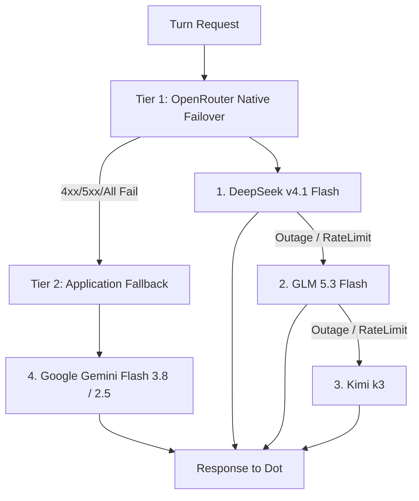

# OpenDots Reasoning Model Fallback Cascade & Employee Capability Architecture

**Date:** 2026-10-12  
**Branch:** `antigravity/feat-opendots-fallback-cascade`  
**Status:** Superseded (2026-10-27). OpenDots was removed from founderos-vps on 2026-10-14; phone access is now Claude Code Remote Control as `claude-agent`.

## 1. Problem & Goal
The founder is using OpenDots as an operating system to simulate human employees (Chief of Staff, Builder, Architect, Reviewer) working on dedicated virtual laptops. To operate at peak performance with minimum cost and zero downtime:
1. **Full Powers:** Dots must operate like real engineers on laptops—leveraging shell commands, files, browser inspection, and superpower developer CLIs (`claude`, `agy`, `gh`) instead of artificial restrictions.
2. **Model Cascade:** Implement a high-speed, cheap reasoning model chain:
   $$\text{DeepSeek v4.1 Flash} \longrightarrow \text{GLM 5.3 Flash} \longrightarrow \text{Kimi k3} \longrightarrow \text{Gemini Flash 3.8 / 2.5}$$
   If DeepSeek is unavailable or rate-limited, fail over to GLM 5.3 Flash, then Kimi k3, and finally to Google Gemini Flash.
3. **UX & Verification:** Ensure seamless daily interaction UX and prove live operation with concrete evidence.

---

## 2. Research Findings & Boundary Analysis

### A. OpenDots Superpowers
OpenDots provides an autonomous desktop/employee environment:
- **Dedicated Virtual Laptop per Dot:** Each agent runs with an isolated Docker container (`opendots-computer-*`).
- **Computer Tools (`computerInputs`):**
  - `computer_exec`: Execute arbitrary bash commands inside `/workspace` (timeout up to 60s).
  - `computer_screenshot`: Capture desktop/browser visual state.
  - `computer_snapshot`: Capture interactive DOM/accessibility tree.
  - `computer_files_list`, `computer_files_read`, `computer_files_write`: Direct workspace file manipulation.
  - `computer_navigate`, `computer_click`, `computer_type`, `computer_key`, `computer_scroll`: Full browser automation.
- **Embedded Engineering Toolchain:** Each container includes `claude`, `agy`, `gh`, `git`, `python3`, `node`, `pnpm`, `curl`, `jq`, `sed`, `awk`, `tar`, `unzip`.
- **Spaces & Documentation:** Built-in Notion-like workspace (`pageTools`) for persistent specs, tickets, and docs.
- **Background Autonomous Shifts:** Scheduled execution via `team-shift` and `shift-cron`.

### B. OpenRouter Model Fallback Mechanics & Constraints
- OpenRouter allows a `models` array parameter in chat completion requests.
- **Constraint Discovered:** OpenRouter enforces a strict limit: **max 3 models** in the `models` array (`Error: 400 'models' array must have 3 items or fewer`).
- **Slugs on OpenRouter:**
  - `deepseek/deepseek-v4.1-flash`: Reasoning-enabled, \$0.14/M input.
  - `z-ai/glm-5.3-flash`: Reasoning-enabled, \$0.10/M input.
  - `moonshotai/kimi-k3`: Reasoning-enabled, \$0.30/M input.
  - `google/gemini-3.8-flash`: Reliable flagship fallback, \$0.15/M input.
- **All 4 models were tested live and verified to support function/tool calling flawlessly.**

---

## 3. Architecture: Two-Tier Tiered Cascade

To cleanly support the user's 4-model chain within OpenRouter's 3-model array limit:

1. **Tier 1 (Sub-second OpenRouter failover):**
   - Primary: `deepseek/deepseek-v4.1-flash`
   - OpenRouter `models` array: `["deepseek/deepseek-v4.1-flash", "z-ai/glm-5.3-flash", "moonshotai/kimi-k3"]`
2. **Tier 2 (OpenDots adapter wrapper fallback):**
   - Primary: `google/gemini-3.8-flash`
   - OpenRouter `models` array: `["google/gemini-3.8-flash", "google/gemini-2.5-flash"]`
   - Activated automatically if Tier 1 encounters an unrecoverable provider error or rate limit.

---

## 4. Implementation Steps

- **Phase 1: Adapter Fallback in `src/server/dot-agent.ts`**
  - Parse comma-separated `OPENAI_MODEL` into fallback tiers.
  - Implement `withModelFallback` wrapping `adapter.chatStream`.
  - Buffer initial chunks so preliminary `RUN_STARTED` from a failed tier is discarded before streaming to the client.
  - Update `opendots-turicks.patch` with the new logic.

- **Phase 2: Configuration & Documentation**
  - Update `deploy/opendots/README.md` to document the fallback cascade syntax.
  - Update `OPENAI_MODEL` in `/opt/opendots/app/.env`.

- **Phase 3: Deploy & Verification on VPS**
  - Apply updated patch on VPS `/opt/opendots/app`.
  - Rebuild and restart `app` container via docker compose.
  - Verify live turn execution, tool invocation, and fallback behavior.
